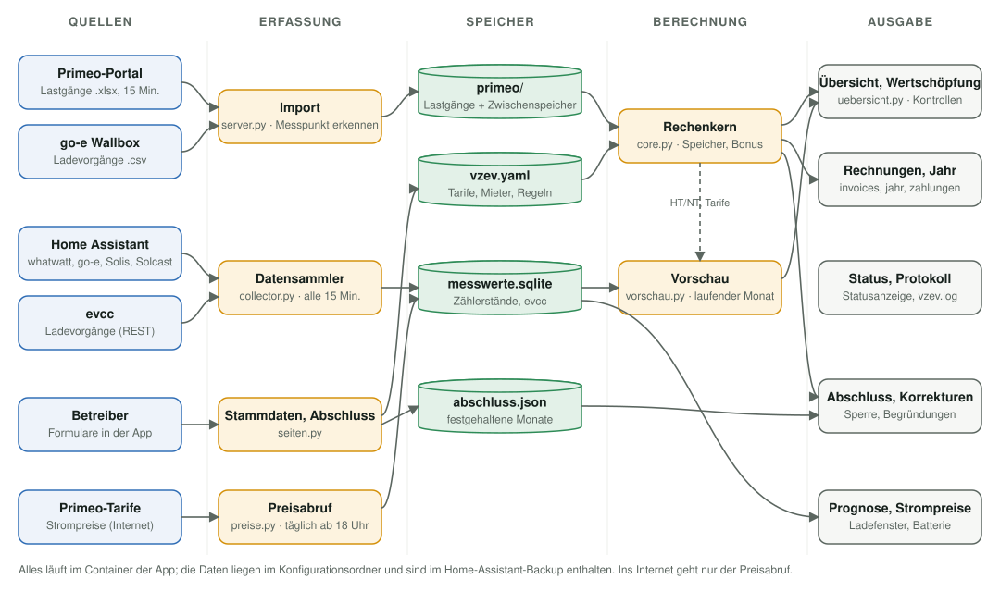
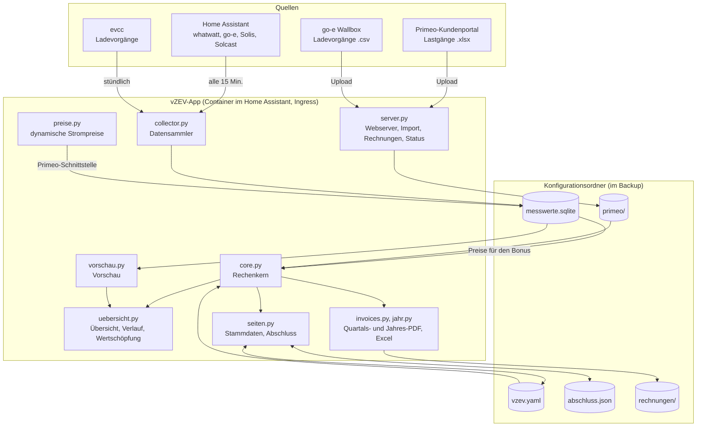
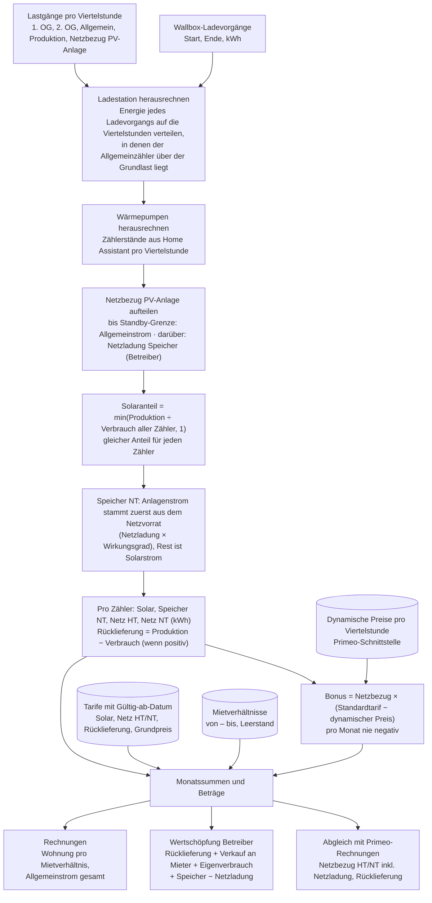
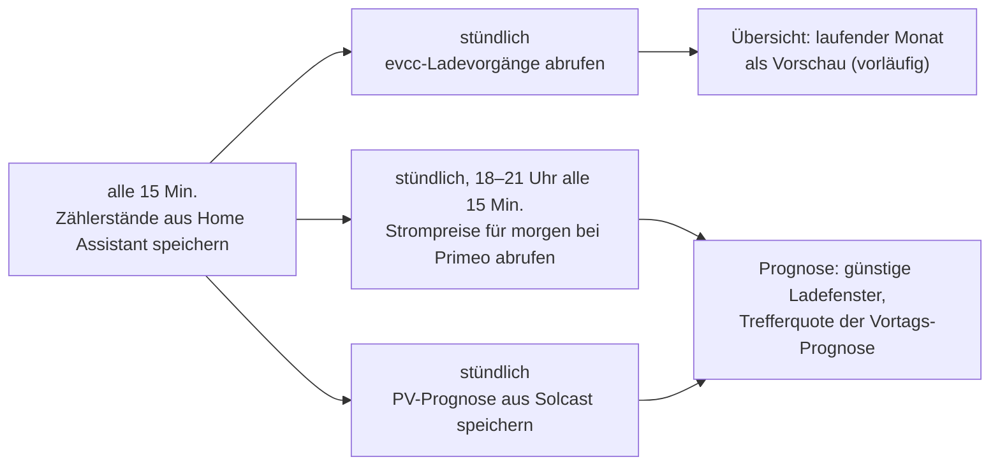
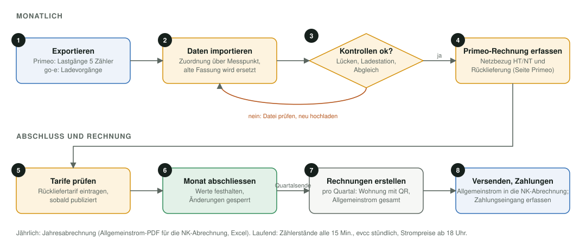
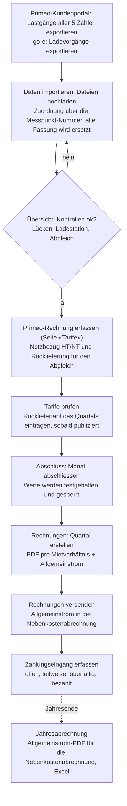
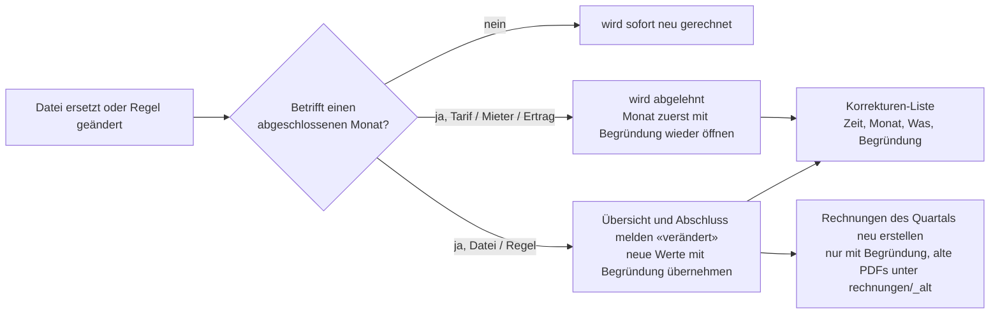

# vZEV Abrechnung – Home-Assistant-App

Abrechnung eines virtuellen Zusammenschlusses zum Eigenverbrauch (vZEV) in der Schweiz:
Primeo-Lastgänge, Ladestation, Wertschöpfung, Quartalsrechnungen mit QR-Einzahlungsschein, Zahlungseingang,
Monatsabschluss, Jahresabrechnung und dynamische Strompreise (ab 2027 mit Bonus für die Mieter und Batteriespeicher). Bedienung siehe [vzev/DOCS.md](vzev/DOCS.md) (in Home Assistant unter «Dokumentation»).

## Installation

Home Assistant → Einstellungen → Apps → App-Store → ⋮ → Repositories →
`https://github.com/khu1985/vzev-ha` hinzufügen, dann «vZEV Abrechnung» installieren.

Persönliche Daten (Namen, IBAN, Messpunkte, Tarife) gehören nicht in dieses Repository,
sondern in die Konfiguration der App (Seite «Einstellungen»).

## Architektur

Die App läuft als Container im Home Assistant und erscheint über Ingress als Seite in der Seitenleiste.
Alle Daten liegen im Konfigurationsordner der App und sind damit im Home-Assistant-Backup enthalten.
Ins Internet geht nur der Abruf der dynamischen Strompreise bei Primeo; alles andere bleibt im lokalen Netz.



<details><summary>Als Mermaid-Diagramm</summary>



</details>

| Datei | Aufgabe |
|---|---|
| `vzev/app/core.py` | Lastgänge einlesen (Messpunkt aus dem Dateikopf), Ladestation auf Viertelstunden verteilen, Solar/Netz pro Zähler aufteilen, Netzladung des Speichers und «Speicher NT», Bonus aus dem dynamischen Tarif, Tarife mit Gültig-ab-Datum, Wertschöpfung, Abgleich mit Primeo-Rechnungen |
| `vzev/app/vorschau.py` | Gleiche Rechnung mit den gesammelten Zählerständen aus Home Assistant für die Zeit nach dem letzten Lastgang |
| `vzev/app/server.py` | Webserver, Navigation, Statusanzeige, Import, Rechnungen, Datensammler-Seite, Protokoll |
| `vzev/app/aufgaben.py` | Aufgaben-Assistent: erkennt pro offenem Monat, Quartal und Jahr, welche Arbeiten erledigt sind, und führt zur passenden Seite |
| `vzev/app/fluss.py` | Startseite «Energiefluss»: animiertes SVG-Diagramm der Flüsse (PV, Netz, Speicher, Haus, Verbraucher) pro Tag, Monat oder Jahr |
| `vzev/app/uebersicht.py` | Übersicht mit Kennzahlen, Kontrollen (u. a. 80-%-Grenze Solarpreis) und Diagramm; Verlauf pro Zähler; Seite Wertschöpfung |
| `vzev/app/seiten.py` | Formulare für Mieter, Tarife (inkl. dynamische Strompreise), Primeo, Batterie und Einstellungen (inkl. Speicher und Bonus); Monatsabschluss und Sperre |
| `vzev/app/invoices.py` | Quartalsrechnungen als PDF: Wohnung mit QR-Einzahlungsschein, Allgemeinstrom als Gesamtrechnung; Spalte «Speicher NT» und Bonus-Zeile, wenn vorhanden |
| `vzev/app/jahr.py` | Jahresabrechnung: Allgemeinstrom-PDF für die Nebenkostenabrechnung, Mieter, Zähler pro Monat, Excel-Export |
| `vzev/app/collector.py` | Speichert alle 15 Minuten die Zählerstände aus Home Assistant, stündlich die evcc-Ladevorgänge und stösst den Preisabruf an |
| `vzev/app/preise.py` | Dynamische Viertelstundenpreise über die Primeo-Schnittstelle abrufen und speichern (Adresse einstellbar) |
| `vzev/app/prognose.py` | PV-Prognose aus Solcast (Sensoren automatisch finden, Prognose und Vortags-Prognose speichern), Seite «Prognose» mit Ladefenstern und Trefferquote |
| `vzev/app/zahlungen.py` | Rechnungsregister: Betrag, Fälligkeit, Zahlungen, Status; Übernahme von Zahlungen bei Korrekturen |
| `vzev/app/diagramme.py` | Säulen-, Linien- und Balkendiagramme als SVG ohne externe Bibliothek |
| `vzev/app/default_config.yaml` | Vorlage für `vzev.yaml` (ohne persönliche Daten) |

## Rechenmodell

Grundlage sind die Primeo-Lastgänge in 15-Minuten-Auflösung. Jede Viertelstunde wird einzeln gerechnet:



<details><summary>Als Mermaid-Diagramm</summary>



</details>

Regeln, die in `vzev.yaml` einstellbar sind:

- **Allgemeinstrom** wird als Gesamtrechnung gestellt (Weiterverrechnung in der Nebenkostenabrechnung). Nur für die Wertschöpfung gilt er zu einem einstellbaren Anteil (Standard 50 %) als an die Mieter verkauft.
- **Leerstand** zählt als Eigenverbrauch des Betreibers; der Grundpreis wird nach Miettagen aufgeteilt.
- **Ladestation** gehört dem Betreiber; ihr Solarstrom zählt als Eigenverbrauch.
- **Wärmepumpen** (Heizung, Warmwasser) am Allgemeinzähler: aus Home-Assistant-Zählerständen pro Viertelstunde herausgerechnet (höchstens bis zum Allgemeinzähler), eigene Gesamtrechnung «Heizung und Warmwasser» für die Heiz- und Nebenkostenabrechnung.
- **Rücklieferung** ohne bekannten Tarif bleibt offen und wird in der Wertschöpfung nicht geschätzt.
- **Speicher** (ab einstellbarem Datum, Standard 01.01.2027): Netzbezug am Zähler der PV-Anlage über der Standby-Grenze ist Netzladung und geht auf den Betreiber. Wird dieser Netzstrom später im Haus verbraucht, erscheint er als «Speicher NT» zum vZEV-Preis statt als Solarstrom.
- **Bonus dynamischer Tarif** (Standard ab 01.01.2027): Die Rechnung bleibt bei HT/NT; der Vorteil gegenüber dem dynamischen Preis pro Viertelstunde wird gutgeschrieben, pro Monat nie negativ.
- **Solarpreis** als Pauschale höchstens 80 % des Standardprodukts; die Übersicht prüft das pro Monat.

## Prozess

### Laufend (automatisch)



<details><summary>Als Mermaid-Diagramm</summary>



</details>

### Monatlich / quartalsweise (von Hand)



<details><summary>Als Mermaid-Diagramm</summary>



</details>

### Korrekturen



<details><summary>Als Mermaid-Diagramm</summary>



</details>

## Dynamische Strompreise (ab 2027)

Ab 01.01.2027 bietet Primeo «Primeo Dynamisch» an (Netz- und Energiepreis pro Viertelstunde).
Die App holt die Preise über die Schnittstelle laut Merkblatt Primeo NetzDynamisch:

```
GET https://tarife.primeo-energie.ch/api/v1/tariffs
    ?start_timestamp=2027-01-01T00:00:00%2B01:00&end_timestamp=2027-01-02T00:00:00%2B01:00
    &tariff_name=NetzDynamisch[&tariff_type=integrated|electricity|grid|grid_usage]
```

- Veröffentlichung täglich bis 18 Uhr für den nächsten Tag; die App ruft stündlich und von 18 bis 21 Uhr alle 15 Minuten ab und lädt fehlende Tage nach.
- Adresse, Tarifname, Tariftyp und Startdatum sind in der App einstellbar (Seite «Tarife»), gespeichert im Abschnitt `dynamisch` von `vzev.yaml`.
- Die Preise enthalten keine kantonalen/kommunalen Abgaben und keine MWST.

So fliessen sie ab 2027 in die Abrechnung ein (Entscheid Betreiber):

- **Rechnung bleibt HT/NT** zum Standardtarif; Solarstrom separat zum vZEV-Preis (Pauschale, höchstens 80 % des Standardprodukts – Kontrolle in der Übersicht).
- **Bonus:** pro Viertelstunde `Netzbezug × (Standardtarif − dynamischer Preis)`, dynamischer Preis = (`integrated` + Konzessionsabgabe × `grid_usage`) × (1 + MWST). Summe als Gutschrift auf der Rechnung, pro Monat nie negativ; ohne publizierten Preis kein Bonus.
- **Speicher:** Netzbezug am Zähler «Netzbezug PV-Anlage» über der Standby-Grenze ist Netzladung (Kosten Betreiber). Ein Vorrat (× Wirkungsgrad) wird beim nächsten internen Verbrauch von Anlagenstrom zuerst aufgebraucht (FIFO); diese kWh erscheinen als «Speicher NT» zum vZEV-Preis statt als Solarstrom.
- Alles gilt ab dem eingestellten Datum (Standard 01.01.2027); abgeschlossene Monate davor bleiben unverändert.

## Daten und Sicherung

| Datei / Ordner | Inhalt |
|---|---|
| `vzev.yaml` | Betreiber, Messpunkte, Tarife, Mietverhältnisse, Regeln, Home-Assistant-Sensoren; frühere Fassung als `vzev.yaml.bak` |
| `primeo/` | importierte Lastgänge und Wallbox-Export; ersetzte Dateien unter `primeo/_entfernt/` |
| `messwerte.sqlite` | Zählerstände aus Home Assistant, evcc-Ladevorgänge, dynamische Strompreise, PV-Prognosen |
| `abschluss.json` | abgeschlossene Monate mit festgehaltenen Werten, Korrekturen |
| `rechnungen/` | erstellte PDFs, `register.json` (Rechnungen, Fälligkeiten, Zahlungen); ersetzte Fassungen unter `rechnungen/_alt/` |
| `vzev.log` | Protokoll (auch in der App unter «Protokoll») |

Alles liegt im Konfigurationsordner der App und ist im Home-Assistant-Backup enthalten.

## Tests

`tests/` prüft Rechenkern, Rechnungen, Vorschau und Web-App mit erfundenen Daten (keine echten Messpunkte oder Namen).
Die Werte sind so gewählt, dass sich die Ergebnisse von Hand nachrechnen lassen, z. B. Energieerhaltung pro Viertelstunde,
Ladestation vollständig verteilt, Grundpreis nach Miettagen, Sperre abgeschlossener Monate, Speicher NT (zuerst geladen,
zuerst verbraucht) und Bonus (nie negativ, ohne Preis kein Bonus).

GitHub führt die Tests bei jeder Änderung aus (`.github/workflows/tests.yml`):

- **Wie im Home Assistant:** im gleichen Debian-Basisimage mit den gleichen Paketversionen wie die App (dort läuft z. B. eine ältere pandas-Version)
- **Neueste Paketversionen:** zeigt früh, wenn künftige Versionen etwas brechen
- **App-Image bauen:** baut das Docker-Image wie Home Assistant und prüft, dass die App startet

Lokal: `python3 -m pytest tests`. Home Assistant nutzt Python 3.11; der Lauf «Wie im Home Assistant» fängt
Syntax ab, die erst neuere Python-Versionen kennen.

## Änderungen

Siehe [vzev/CHANGELOG.md](vzev/CHANGELOG.md).
