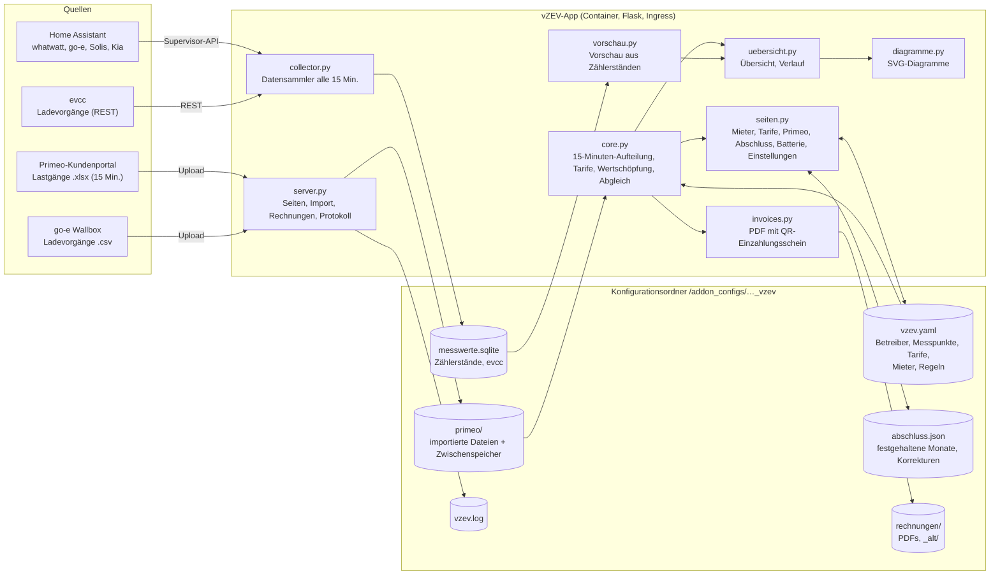
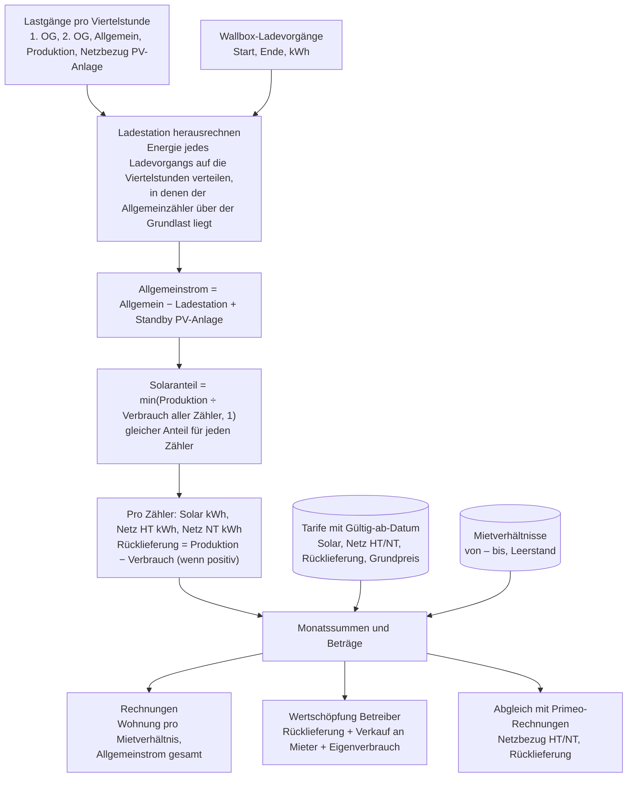
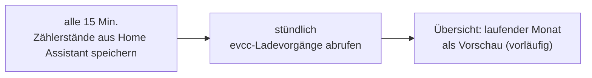
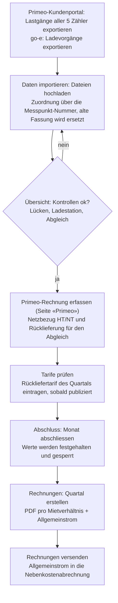
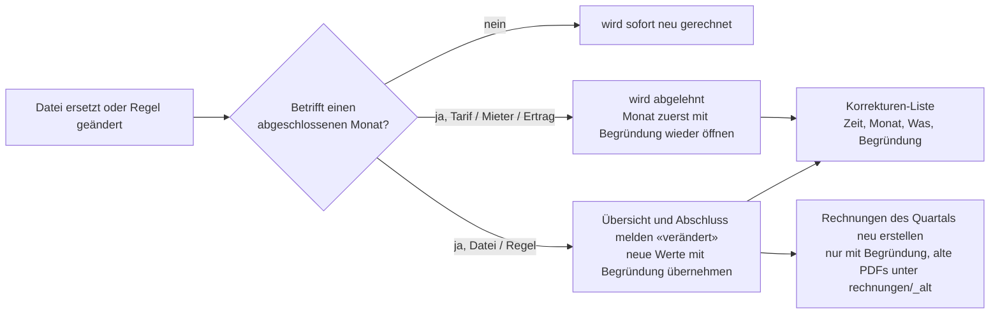

# vZEV Abrechnung – Home-Assistant-App

Abrechnung eines virtuellen Zusammenschlusses zum Eigenverbrauch (vZEV) in der Schweiz:
Primeo-Lastgänge, Ladestation, Wertschöpfung und Quartalsrechnungen mit QR-Einzahlungsschein.

## Installation

Home Assistant → Einstellungen → Apps → App-Store → ⋮ → Repositories →
`https://github.com/khu1985/vzev-ha` hinzufügen, dann «vZEV Abrechnung» installieren.

Persönliche Daten (Namen, IBAN, Messpunkte, Tarife) gehören nicht in dieses Repository,
sondern in die Konfiguration der App (Seite «Einstellungen»).

## Architektur

Die App läuft als Container im Home Assistant und erscheint über Ingress als Seite in der Seitenleiste.
Sie braucht kein Internet: Alle Daten liegen im Konfigurationsordner der App und sind damit im Home-Assistant-Backup enthalten.

| Datei | Aufgabe |
|---|---|
| `vzev/app/core.py` | Lastgänge einlesen (Messpunkt aus dem Dateikopf), Ladestation auf Viertelstunden verteilen, Solar/Netz pro Zähler aufteilen, Tarife mit Gültig-ab-Datum, Wertschöpfung, Abgleich mit Primeo-Rechnungen |
| `vzev/app/vorschau.py` | Gleiche Rechnung mit den gesammelten Zählerständen aus Home Assistant für die Zeit nach dem letzten Lastgang |
| `vzev/app/server.py` | Webserver, Navigation, Import, Rechnungen, Datensammler-Seite, Protokoll |
| `vzev/app/uebersicht.py` | Übersicht mit Kennzahlen, Kontrollen und Diagramm; Verlauf pro Zähler |
| `vzev/app/seiten.py` | Formulare für Mieter, Tarife, Primeo, Batterie und Einstellungen; Monatsabschluss und Sperre |
| `vzev/app/invoices.py` | Quartalsrechnungen als PDF: Wohnung mit QR-Einzahlungsschein, Allgemeinstrom als Gesamtrechnung |
| `vzev/app/collector.py` | Speichert alle 15 Minuten die Zählerstände aus Home Assistant und stündlich die evcc-Ladevorgänge |
| `vzev/app/diagramme.py` | Säulendiagramme als SVG ohne externe Bibliothek |
| `vzev/app/default_config.yaml` | Vorlage für `vzev.yaml` (ohne persönliche Daten) |

## Rechenmodell

Grundlage sind die Primeo-Lastgänge in 15-Minuten-Auflösung. Jede Viertelstunde wird einzeln gerechnet:

Regeln, die in `vzev.yaml` einstellbar sind:

- **Allgemeinstrom** wird als Gesamtrechnung gestellt (Weiterverrechnung in der Nebenkostenabrechnung). Nur für die Wertschöpfung gilt er zu einem einstellbaren Anteil (Standard 50 %) als an die Mieter verkauft.
- **Leerstand** zählt als Eigenverbrauch des Betreibers; der Grundpreis wird nach Miettagen aufgeteilt.
- **Ladestation** gehört dem Betreiber; ihr Solarstrom zählt als Eigenverbrauch.
- **Rücklieferung** ohne bekannten Tarif bleibt offen und wird in der Wertschöpfung nicht geschätzt.

## Prozess

### Laufend (automatisch)

### Monatlich / quartalsweise (von Hand)

### Korrekturen

## Daten und Sicherung

| Datei / Ordner | Inhalt |
|---|---|
| `vzev.yaml` | Betreiber, Messpunkte, Tarife, Mietverhältnisse, Regeln, Home-Assistant-Sensoren; frühere Fassung als `vzev.yaml.bak` |
| `primeo/` | importierte Lastgänge und Wallbox-Export; ersetzte Dateien unter `primeo/_entfernt/` |
| `messwerte.sqlite` | Zählerstände aus Home Assistant und evcc-Ladevorgänge |
| `abschluss.json` | abgeschlossene Monate mit festgehaltenen Werten, Korrekturen |
| `rechnungen/` | erstellte PDFs; ersetzte Fassungen unter `rechnungen/_alt/` |
| `vzev.log` | Protokoll (auch in der App unter «Protokoll») |

Alles liegt im Konfigurationsordner der App und ist im Home-Assistant-Backup enthalten.

## Änderungen

Siehe [vzev/CHANGELOG.md](vzev/CHANGELOG.md).
